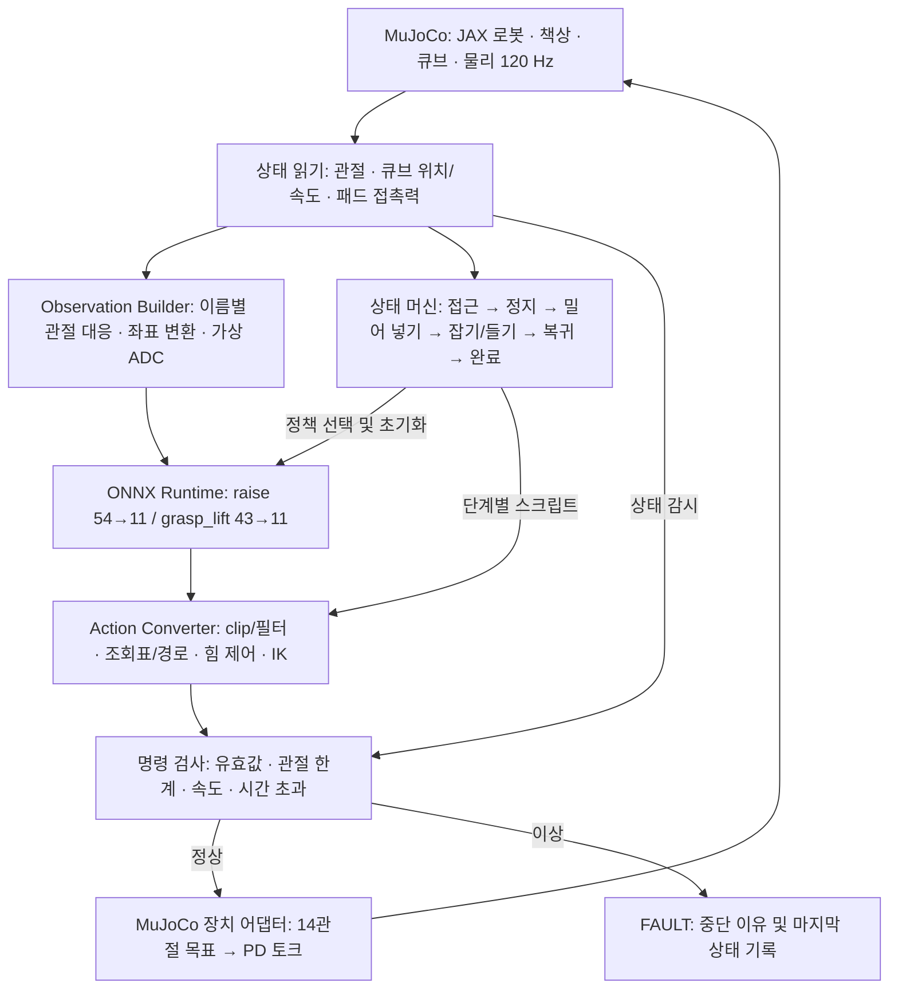

# JAX 정책 실행 구조와 큐브 배치 기준

현재 실행 장면은 사용자 지정으로 큐브를 한 변 4 cm, 50 g, 마찰계수 0.4로 변경했다.
아래 5.5 cm 및 z=0.7675 m 설명은 원본 학습 배치의 기준 설명이다.
현재 큐브 중심은 73.5 cm 책상에서 z=0.755 m, 74 cm 책상에서 z=0.760 m다.
수평 기준점은 유지한다.

## 목표 제어 구조

아래 흐름은 `python -m deploy.run`에 실험적으로 연결되어 있다.
책상·큐브·가상 패드 힘/ADC·두 ONNX 정책·전체 체인을 실행하지만,
MuJoCo에서 파지 완료 조건 달성은 아직 확인되지 않았다. 실물 어댑터는 없다.



Controller는 60 Hz로 실행한다. 기본 설정에서는 명령 한 번마다 물리 2스텝을 계산한다.
시뮬과 실물은 장치 어댑터를 교체하는 구조로 만든다.
실물 어댑터는 아직 없으며, 실제 센서 보정·CAN 프로토콜·정지 동작 확인이 선행되어야 한다.
기존 dry-run은 별도의 연결 확인 도구로 물리 600 Hz와 임의 게인을 사용한다.

## 물체 배치의 (0, 0)

배치용 `(dx, dy) = (0, 0)`은 **큐브 기준 위치로부터의 수평 오프셋이 0**이라는 뜻이다.
월드 좌표 원점이나 로봇 베이스 원점이 아니다.

```text
cube_world_x = -0.285 + dx
cube_world_y =  0.260 + dy
cube_world_z =  0.7675 + dz
```

위치는 m 단위이며 z는 5.5 cm 큐브의 중심이다.
기준 책상 윗면 0.740 m + 큐브 반 높이 0.0275 m = 0.7675 m다.
`dz`는 책상 높이 변화이고 배치용 수평 `(dx,dy)`와 별도다.

- 배치 `(0, 0)` → 큐브 중심 월드 `(-0.285, 0.260, 0.7675)` m
- 배치 `(-3 cm, 0)` → 큐브 중심 월드 `(-0.315, 0.260, 0.7675)` m
- 월드 원점 → `(0, 0, 0)` m
- 로봇 베이스 원점의 월드 위치 → `(0, 0, 0.305)` m
- 책상 앞 모서리 → 월드 `x=-0.225` m. 기준 큐브 중심은 여기서 −x 방향으로 6 cm 안쪽이다.

### 위에서 본 배치

```text
                         월드 +y
                            ↑
   책상 영역                │
   (−x 쪽)                  │
                            │
   ● 기준 큐브              │
   x=-0.285, y=+0.260       │
   배치 오프셋=(0,0)        │
                            │
────────────────────────────O────────→ 월드 +x
                       월드 x=y=0
                       로봇 베이스 x=y=0
```

개념도이며 축척은 생략했다. 로봇 베이스는 월드 원점보다 z 방향으로 0.305 m 높다.
베이스는 월드 z축 기준 −90° 회전하므로 베이스 x=월드 −y, 베이스 y=월드 +x다.
기준 큐브 중심을 베이스 좌표로 표현하면 `(-0.260, -0.285, 0.4625)` m다.
잡기 정책의 29번 위치 보정 −0.115 m를 적용하면 위치 입력은 `(-0.260, -0.400, 0.4625)`다.
관측 보정은 신경망 입력에만 사용하며 큐브를 실제로 이동시키지 않는다.

## 현재 viewer와의 차이

`inspect_model`은 URDF 베이스 원점을 월드 원점에 둔 로봇만 보여준다.
`inspect_model`에 책상·큐브는 없다. `play_scene`과 `deploy.run`에는 배치·회전과 책상·큐브가 있다.
초록 `placement_0_0` 마커가 배치 기준점의 수평 위치를 나타낸다.
`reference`는 이 문서의 원래 배치, `edge10`은 높이 73.5 cm로 변경한 배치,
`center10`은 높이 73.5 cm에 베이스 중심–모서리 간격 10 cm인 별도 실험 배치다.
원래 배치의 큐브 z=0.7675 m는 실측 높이 배치에서는 0.7625 m로 달라진다.

근거: `JaxIsaacLab/artifacts/deploy_2026-11-05/README.md` 4절, 7.1절, 8.1절, 10절.
